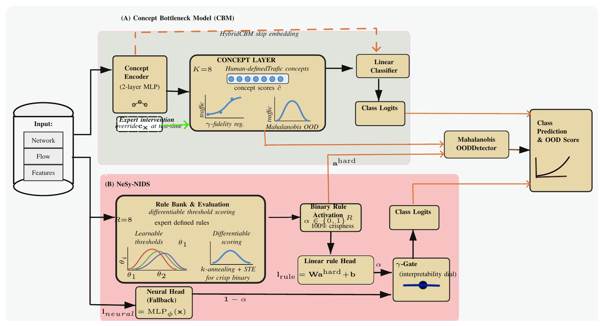

# Towards Trustworthy IoT Network Security: Interpretable Open-Set Intrusion Detection

**Under review, 2026**  
Crisphine Macharia Ngari and Ning Weng, Southern Illinois University Carbondale

[](https://github.com/crisphinen/interpretable-nids)

---

## Overview

This repository contains the code, data splits, trained models, results and manuscript for our study of two inherently interpretable architectures for IoT network intrusion detection and open-set (OOD) detection:

- **Concept Bottleneck Models (CBMs)**: predictions routed through human-defined traffic concepts; supports test-time intervention
- **Neuro-Symbolic NIDS (NeSy-NIDS)**: domain-expert threshold rules learned through *k*-annealed sigmoid gates; activations binarised for audit and OOD scoring

Both are scored for OOD detection by per-class Mahalanobis distance in their own representation space, on **CTU-IoT-23** (4 known / 9 unknown families), **CIC-IoT-2023** (5 known / 29 unknown) and, for the concept-space geometry analysis, **TON_IoT** (5 known / 5 unknown).

Every result in the paper comes from this code, on splits the scripts draw deterministically, with every training run seeded. [`REPRODUCE.md`](REPRODUCE.md) lists the commands in run order, and `checks/paper_values.py` prints every table value from the files in `results/`.



*Fig. 1. (A) a concept bottleneck with test-time intervention and (B) a differentiable rule bank with a neural fallback, both scored for OOD by per-class Mahalanobis distance.*

---

## Repository Structure

```
interpretable-nids/
├── cbm/                       # Concept Bottleneck Models, MLP baseline and the experiment drivers
│   ├── model.py               # MLPBaseline, JointCBM, SequentialCBM, HybridCBM
│   ├── concepts.py            # concept definitions (K=8 per dataset)
│   ├── train.py, evaluate.py  # training and OOD scoring
│   ├── run_*.py               # multi-seed runs, splits, scorers, fidelity, open-set, LOFO, geometry, sweeps
│   └── make_*figure*.py       # paper figures
├── nesy/                      # NeSy-NIDS: rule bank, training with k-annealing, evaluation, fidelity
├── checks/                    # paper_values.py: prints every table value from results/
├── data/                      # deterministic splits, one folder per experiment (see Data)
├── results/
│   ├── cbm/                   # CBM/MLP checkpoints (ms/*.pt) and result JSONs
│   ├── nesy/                  # NeSy-NIDS checkpoints and per-seed eval JSONs
│   └── figures/               # figures written by the analysis drivers
├── paper/                     # manuscript, supplement and figures (LaTeX)
├── preprocess/                # raw-data download and DuckDB build scripts
├── 02_make_splits.py          # original-feature CTU split (data/*.parquet, used by the λ ablations)
├── 04_make_splits_ciciot23.py # CIC-IoT-2023 splits (data/cicr, data/cicr_alt)
├── 06_make_kfs_splits.py      # CTU splits: known-only features, submitted features, alternative, temporal
├── 07_make_splits_ton.py      # TON_IoT splits (data/ton)
├── config.py, cic_config.py, ton_config.py
├── REPRODUCE.md               # every command, in run order
└── requirements.txt
```

---

## Setup

```bash
python -m venv venv && source venv/bin/activate
pip install -r requirements.txt
```

CUDA 11.8 is recommended. For CPU-only, replace `torch>=2.4.0` with the appropriate CPU wheel. The split scripts use the DuckDB CLI (`duckdb==1.4.1`); put it on your `PATH` or set `DUCKDB_BIN`.

---

## Data

Each split folder holds `train`, `val`, `test_known` and `test_unknown` parquet files and a `vocab.json` (feature columns, label IDs, categorical vocabularies). The folder name is the dataset tag used in every result file.

| Folder | Contents | Included |
|---|---|---|
| `data/ctuk` | CTU-IoT-23, features selected on known-class training rows only (main CTU results) | yes |
| `data/ctuko` | CTU-IoT-23, same rows, originally submitted feature list (ablation) | yes |
| `data/ctualt`, `data/ctut` (+ `_o` controls) | CTU alternative known set and timestamp-ordered split | yes |
| `data/ctuk_lofo_*` | CTU leave-one-family-out folds | yes |
| `data/ton` | TON_IoT | yes |
| `data/cicr`, `data/cicr_alt`, `data/cicr_lofo_*` | CIC-IoT-2023 | `vocab.json` only; regenerate (below) |
| `data/*.parquet`, `data/ctu`, `data/cic` | original-feature CTU split and vocabularies, used by the λ and (λ, γ) ablations | parquet and vocab files |

**CTU-IoT-23**: [Stratosphere Laboratory](https://www.stratosphereips.org/datasets-iot23). To regenerate the splits, build `data/iot23_3.duckdb` with the scripts in `preprocess/` and run `python 06_make_kfs_splits.py` (see `REPRODUCE.md` for the alternative, temporal and control splits).

**CIC-IoT-2023**: [CIC](https://www.unb.ca/cic/datasets/iotdataset-2023.html). The unknown pool (about 40M flows) is too large for GitHub, so generate the splits:

1. `python preprocess/download_cciot23_csv.py` saves one folder per class under `downloads/csv/` and renames the server's `DDoS-PSHACK_FLOOD` / `DDoS-RSTFINFLOOD` folders to the names the config expects.
2. `python preprocess/merge_ciciot23.py` builds `data/ciciot23.duckdb` (`--csv-dir` / `--out` to change paths).
3. `python 04_make_splits_ciciot23.py --name cicr --order-by-rowid` writes `data/cicr` (about 60 GB RAM, 2 minutes); add `--alt` with `--name cicr_alt` for the alternative known set.

**TON_IoT**: [UNSW](https://research.unsw.edu.au/projects/toniot-datasets). `python 07_make_splits_ton.py` builds `data/ton` from the `Processed_Network_dataset` CSVs under `downloads/TON_IoT/` (or the glob in `TON_CSV_GLOB`).

---

## Reproducing Results

[`REPRODUCE.md`](REPRODUCE.md) gives every command in run order (splits, main runs, baselines, robustness splits, TON_IoT, fidelity, open-set, leave-family-out, geometry, sweeps), followed by the commands that regenerate the manuscript figures, and

```bash
python checks/paper_values.py
```

prints every value in the manuscript and supplement tables from `results/`.

---

## From results to tables

`python checks/paper_values.py` prints every value below from these files. Splits are the parquet folders under `data/` (indices are fixed by the deterministic split scripts); every table uses seeds 0–4 unless stated.

| Manuscript table or figure | Split(s) | Results file(s) | Driver |
|---|---|---|---|
| Main results (F1, AUROC, TPR; submitted-list AUROC column) | `ctuk`, `ctuko`, `cicr` | `results/cbm/multiseed_{ds}_v2.json`, `results/cbm/baselines_{ds}.json`, `results/nesy/{ds}_{nesy,rule_only}_s*_eval.json` (F1), `results/nesy/shared_eval_{ds}.json` (AUROC, TPR) | `cbm/run_kfs_control.py`, `cbm/run_multiseed.py`, `nesy/run_kfs_control.sh`, `cbm/run_baselines.py` |
| Temporal split; JointCBM AUROC vs γ on every split | `ctut`, `ctut_o`, `ctualt`, `ctualt_o`, `cicr_alt` | `results/cbm/multiseed_{ds}_v2_seeds.json`, `results/nesy/ctut*_eval.json` | `cbm/run_multiseed.py` |
| NeSy-NIDS scorer ablation | `ctuk`, `cicr` | `results/nesy/shared_eval_{ds}.json` | `nesy/run_shared_eval.py` |
| Mahalanobis vs. energy by architecture | `ctuk`, `cicr`, `ton` | `results/cbm/scorer_factorial_{ctuk_ctuko,cicr,ton}.json` | `cbm/run_scorer_factorial.py` |
| Leave-family-out scorer selection | `{ctuk,cicr}_lofo_*` | `results/cbm/lofo.json` | `cbm/run_lofo.py` |
| Synthetic-outlier scorer selection | `ctuk`, `cicr`, `ton` | `results/cbm/scorer_selection_ctuk_cicr_ton.json` | `cbm/run_scorer_selection.py` |
| Open-set (C+1), per-family, confusion matrix | `ctuk`, `cicr` | `results/cbm/openset_{ctuk,cicr}.json` | `cbm/run_openset.py` |
| Post-hoc detectors on the MLP | `ctuk`, `cicr` | `results/cbm/ood_baselines_{ds}_seeds.json` | `cbm/run_ood_baselines.py --seeds 5` |
| Device-disjoint splits | CTU `ctud_h198`, `ctud_h111`, `ctud_h108` and the `ctud_o_*` controls; TON_IoT `tond_a30`, `tond_a31` | `results/cbm/multiseed_{ds}_v2.json`, `results/nesy/shared_eval_{ds}.json`, `results/nesy/{ds}_*_eval.json` | `06_make_kfs_splits.py --split device`, `07_make_splits_ton.py --holdout-attacker`, `cbm/run_multiseed.py`, `nesy/run_kfs_control.sh` |
| Open-set test with the held-out address's own unknown flows (AUROC, diagnostic TPR, validation-threshold rejection and recall); seen-address baselines | `ctud_h198`, `ctud_o_h198`, `tond_a30`, `tond_a31`; `ctuk`, `ton` | `results/cbm/device_openset.json` | `cbm/run_device_openset.py` |
| CTU retained labels and flows without a DPKT match | `iot23_3.duckdb` | `results/cbm/ctu_label_counts.json` | `checks/ctu_label_counts.py` |
| Same-class train/test duplicate shares | `ctuk`, `ctud_*`, `ton`, `tond_*` | `results/cbm/split_overlap.json` | `cbm/run_split_overlap.py` |
| 95% confidence intervals of AUROC comparisons | `ctuk`, `cicr`, `ton` | `results/cbm/bootstrap_ci.json` | `cbm/run_bootstrap_ci.py` |
| 8-unit bottleneck control | `ctuk`, `cicr`, `ton` | `results/cbm/bottleneck8_{ds}.json` | `cbm/run_bottleneck_control.py` |
| Restored-features control | `ctuk_n` | `results/cbm/multiseed_ctuk_n_v2.json` | `08_make_ctuk_n.py`, `cbm/run_multiseed.py` |
| Fidelity, branch agreement, α sweep, rule quality, threshold drift | `ctuk`, `cicr` | `results/cbm/fidelity_{ds}.json`, `results/nesy/fidelity_{ds}.json`, `results/nesy/rule_init_{ds}.json` | `cbm/run_fidelity.py`, `nesy/run_fidelity.py`, `nesy/run_rule_init.py` |
| Known-class geometry, LOCO, confounding figure, k_T sweep | `ctuk`, `cicr`, `ton` | `results/cbm/geometry.json` | `cbm/run_geometry.py` |
| Leave-one-corpus-out geometry transfer | `ctuk`, `cicr`, `ton` | `results/cbm/geometry_transfer.json` | `cbm/run_geometry_transfer.py` |
| λ sensitivity and (λ, γ) grid | `ctuk`, `cicr` | `results/cbm/lambdagrid_{ds}_seeds.json` | `cbm/run_lambda_grid.py` |
| Per-class F1 | `ctuk`, `cicr` | `results/cbm/perclass_{ds}.json` | `cbm/run_perclass.py` |

---

## Pre-trained Models

| Path | Contents |
|---|---|
| `results/cbm/ms/{ds}_{variant}_s{seed}.pt` | MLP and CBM models, seeds 0–4, for every split tag `{ds}` |
| `results/nesy/{ds}_nesy_s{seed}.pt` | NeSy-NIDS, seeds 0–4 |
| `results/nesy/{ds}_nesy_s{seed}_a{λα}.pt` | NeSy-NIDS α-gate sweep |
| `results/nesy/{ds}_nesy_s{seed}_k{kT}.pt` | NeSy-NIDS annealing-endpoint sweep |
| `results/nesy/{ds}_rule_only_s{seed}.pt` | Rule-only ablation |
| `results/cbm/{ctu,cic}_*.pt`, `results/nesy/{ctu,cic}_*` | runs on the original-feature splits `ctu` and `cic` |

CBM checkpoints hold `model_state_dict` plus the constructor sizes; NeSy checkpoints also record their dataset, which selects the rule bank. Load from the repo root with:

```python
import torch
from cbm.model import JointCBM
from nesy.evaluate import load_model

ck = torch.load("results/cbm/ms/ctuk_JointCBM_g0_s0.pt", map_location="cpu", weights_only=False)
cbm = JointCBM(ck["n_features"], ck["n_concepts"], ck["n_classes"], 64)
cbm.load_state_dict(ck["model_state_dict"])

nesy, _ = load_model("results/nesy/ctuk_nesy_s0.pt", torch.device("cpu"))
```

---

## Key Results

Weighted F1 on the known-class test split; OOD AUROC for known-class test flows against held-out unknown-class flows, with per-class Mahalanobis scores fitted on training activations (DT: raw features; RF: 1 − max p). Mean ± std over five seeds (manuscript Table III).

| Model | CTU F1 | CTU AUROC | CIC F1 | CIC AUROC |
|---|---|---|---|---|
| MLP Baseline | 0.9331 | 0.874±.002 | 0.8186 | **0.807±.007** |
| JointCBM (γ=0) | 0.9330 | 0.823±.044 | 0.8183 | 0.717±.017 |
| JointCBM (γ=0.1) | 0.9331 | 0.805±.035 | 0.8188 | 0.700±.009 |
| JointCBM (γ=0.5) | 0.9330 | 0.844±.036 | 0.8184 | 0.702±.007 |
| JointCBM (γ=1.0) | 0.9331 | 0.834±.050 | 0.8182 | 0.699±.013 |
| SequentialCBM | 0.5673 | 0.872±.026 | 0.7321 | 0.667±.005 |
| HybridCBM | 0.9331 | 0.822±.055 | 0.8188 | 0.669±.015 |
| Post-hoc CBM | 0.5758 | 0.871±.024 | 0.7457 | 0.652±.018 |
| NeSy-NIDS | 0.9331 | 0.904±.014 | 0.8186 | 0.657±.028 |
| NeSy + α-reg (λα=0.1) | 0.9330 | **0.909±.014** | 0.8198 | 0.691±.018 |
| Rule-only | 0.5660 | 0.870±.011 | 0.7498 | 0.668±.038 |
| Decision Tree | 0.9337 | 0.679 | 0.8145 | 0.802 |
| Random Forest | 0.9338 | 0.657±.034 | 0.8057 | 0.704±.006 |

**Main findings**

- **Accuracy without full fidelity.** JointCBM and NeSy-NIDS match the MLP on known-class F1 (within 0.002), but their declared concepts and rules only partly explain the predictions: replacing a CBM's concepts with the declared predicates drops CTU F1 from 0.933 to 0.46–0.49, and NeSy-NIDS agrees with its rule head on only 32–55% of flows.
- **A sequential bottleneck gives up accuracy, not CTU detection.** SequentialCBM detects unknown CTU families as well as the MLP (0.872 vs 0.874) despite F1 0.567.
- **Concept-fidelity regularisation (γ) is not a lever.** Its effect on AUROC changes sign across five dataset/split combinations (|Δ| ≤ 0.06) and, in a joint (λ, γ) grid, across λ.
- **The best scorer depends on dataset and architecture.** Mahalanobis wins on CTU for every architecture; on CIC the logit-energy score wins for JointCBM and NeSy-NIDS; on TON_IoT energy wins for every architecture. Neither selection rule we tested from known traffic (leave-family-out, feature-permuted synthetic outliers) picks the better scorer on every corpus.
- **Known-class geometry is associated with detectability on CIC and TON_IoT, not predictive.** All seven statistics agree in direction there; on CTU the signs reverse and a leave-one-configuration-out check shows a single configuration (SequentialCBM) sets them. Fitted on two corpora, no statistic identifies the best configuration on the third (1 of 21 cases).
- **On later traffic every model loses CTU DDoS**, whose two capture regimes split across the timestamp boundary, while the interpretable models still track the MLP on the other classes.

---

## Development Notes

Run every module from the repo root with `python -m`. There is no test suite, linter or build step.

### Command options

```bash
# CBM: trains MLPBaseline, JointCBM, SequentialCBM and HybridCBM (choose with --models)
python -m cbm.train    --dataset ctu [--gamma 0.5] [--models JointCBM] [--device cuda] [--overwrite]
python -m cbm.evaluate --dataset ctu [--gamma 0.5] [--models JointCBM]

# NeSy-NIDS: one seed per run; --model rule_only for the rule-only ablation
python -m nesy.train    --dataset cic --seed 0 [--lambda_alpha 0.1] [--model rule_only]
python -m nesy.evaluate --dataset cic --seed 0 [--lambda_alpha 0.1]
python -m nesy.evaluate --dataset cic --multi_seed 5   # aggregates {ds}_nesy_s{0..4}.pt (λα=0 only)
```

The other `cbm/run_*.py` and `nesy/run_*.py` scripts are the paper experiments: multi-seed runs, λ/γ/k sweeps, temporal and alternative splits, and the scorer, fidelity, open-set and geometry analyses; `REPRODUCE.md` gives their order and arguments. `cbm/make_figures.py` is legacy. It expects an older eval-file format (`ood_auroc`; current files use `ood_auroc_mahal`) and crashes on current results.

### Settings

Paths inside the project resolve from the repo root. Machine-specific settings come from environment variables:

| Variable | Default | Used by |
|---|---|---|
| `PYTHON` | `python3` | `cbm/run_experiments.sh`, `nesy/run_alpha_sweep.sh` |
| `DUCKDB_BIN` | `duckdb` on your `PATH` | split scripts, `preprocess/merge_ciciot23.py` |
| `IOT23_DB` | `data/iot23_3.duckdb` | `config.py` |
| `TON_CSV_GLOB` | `downloads/TON_IoT/Processed_Network_dataset/Network_dataset_*.csv` | `ton_config.py` |
| `DUCKDB_SPILL_DIR` | `/tmp/duckdb_spill` | `preprocess/merge_iot23_outer*.py` |
| `EXTRA_FIG_DIRS` | none | `make_paper_figures.py`, `make_alpha_figure.py` (`:`-separated extra output folders) |

`config.py` and `cic_config.py` are read by the two split scripts and by `cbm/run_temporal.py`. Training hyperparameters are constants at the top of each `train.py`. Label IDs and feature columns come from `vocab.json`.

### Checkpoint and result names

- File names encode the hyperparameters, and the evaluate scripts derive the name to find a checkpoint:
  - CBM: `{ds}_{Model}{_g<γ>}.pt`
  - NeSy: `{ds}_{nesy|rule_only}_s{seed}{_sp<λs>}{_a<λα>}.pt`
  - Default (0) values get no suffix.
- `nesy.evaluate` adds only the `_a` suffix (it has no `--lambda_sparse`). `--multi_seed` always loads the λα=0 models, whatever `--model` or `--lambda_alpha` says.
- `cbm.train` and `run_alpha_sweep.sh` skip checkpoints that already exist, which protects the archived runs. Pass `--overwrite` to `cbm.train` to retrain.
- `results/nesy/` holds both the main seeds (`{ds}_nesy_s{0-4}_eval.json`) and the α-sweep runs (`{ds}_nesy_s{seed}_a{λ}_eval.json`). Match the main seeds with `s[0-9]_eval.json` or exact names, never `s*_eval.json`, which also picks up all 25 sweep runs.

### How the code fits together

**Shared pipeline.**
- Each `train.py` has its own `load_dataset()`. It keeps only the known classes listed in `vocab.json` and renumbers their labels `0..n_classes-1` in sorted order.
- Each `evaluate.py` also loads a subsample of `test_unknown.parquet`.
- OOD scoring fits per-class Mahalanobis distances on training embeddings. It can optionally z-normalise them and combine them with an energy score.
- The evaluators report AUROC and TPR at 5% FPR. `config.FPR_LEVELS` is not used.

**CBM (`cbm/`).**
- `concepts.py` defines 8 binary concepts per dataset as threshold rules on raw flow features. These are the concept supervision targets.
- `model.py` builds every variant on a shared `MLPEncoder`:
  - `JointCBM` trains concepts and classes together (concept loss weight `LAMBDA_CONCEPT=0.5`), with an optional `--gamma` concept-fidelity regulariser.
  - `SequentialCBM` trains the concept head first, then the classifier on frozen concepts.
  - `HybridCBM` adds a residual side channel.
- `evaluate.py` also runs the concept-accuracy and test-time intervention experiments.

**NeSy-NIDS (`nesy/model.py`).**
- `NeSyNIDS` combines a `RuleBank` and a `NeuralFallback` MLP, mixed by a learned gate α = sigmoid(param).
- Each `DiffRule` is a product of sigmoid gates `σ(k·(x−θ))` with learnable thresholds θ, built from a `RuleTemplate` in `CTU_RULES` / `CIC_RULES`.
- **Rule templates refer to features by column index**, so they break if the feature order in `vocab.json` changes.
- Training raises the gate steepness k linearly from 1 to 10 over 30 epochs (`get_k` in `train.py`). Evaluation uses `K_EVAL=10`, optionally with straight-through binarisation.
- `--lambda_alpha` penalises (1−α)² to push weight toward the rules. `RuleOnlyNIDS` drops the neural fallback.
- `evaluate.py` also reports rule crispness, class selectivity and the rule-editing experiments.

---

## Citation

```bibtex
@unpublished{ngari2026interpretable,
  author = {Ngari, Crisphine Macharia and Weng, Ning},
  title  = {Towards Trustworthy IoT Network Security: Interpretable Open-Set
            Intrusion Detection},
  note   = {Under review},
  year   = {2026},
}
```

---

## License

Code released under the MIT License. Dataset terms follow the respective dataset providers (Stratosphere Lab, UNB CIC, UNSW Canberra for TON_IoT); please cite the original datasets when using the included splits.
